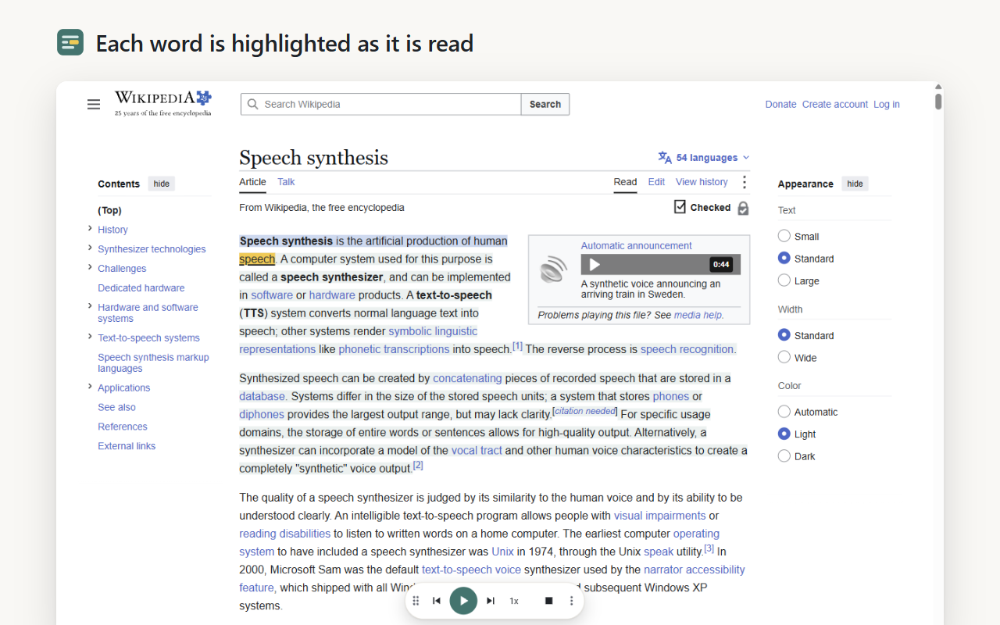

  
  <h1>ReadFollow</h1>
  Text to speech that highlights each word on the page as it reads, so you can follow along.

## What it does

Select some text on any page and start reading (toolbar button, `Alt+O`, or right-click > read selection). While it reads:

- the current sentence is highlighted, and the word being spoken is marked on top of it
- the text you selected stays lightly tinted, so you can see how much is left
- a small bar gives you previous/next sentence, play/pause, speed and stop; drag it anywhere, and it remembers the spot on each site
- clicking any word in the selection jumps reading to that word

It works the same way in PDFs, in a bundled PDF.js viewer. Clicking the toolbar button with nothing selected reads the whole page, with the text shown in the popup.

Voices built into Windows, macOS and ChromeOS report each word as they speak it. Online voices (Google Translate, and OpenAI, Azure, Amazon Polly or IBM with your own key) and the downloadable Piper voices that run on your device don't, so ReadFollow works out the word from the length of each piece of audio.

Highlight colors, speed, voice and per-language voices are in Settings. The interface is translated into 27 languages, including Arabic and Hebrew right to left.

Works in Chrome 125 or newer and Firefox 140 or newer.

## Install from source

**Chrome:** open `chrome://extensions`, turn on Developer mode, click "Load unpacked" and pick this folder.

**Firefox:** run `npm run build:firefox`, then load `build/firefox/manifest.json` from `about:debugging` > This Firefox > Load Temporary Add-on. A temporary add-on is removed when Firefox restarts; a permanent install needs a signed build.

## Releasing

Raise `version` in `manifest.json` and `package.json` and merge to main. CI lints the Firefox build, checks that `vendor/piper` matches a fresh build of `piper/`, and then publishes to Firefox Add-ons and the Chrome Web Store and creates a GitHub Release. To publish the current version again, run the CI workflow by hand with "publish" ticked. Store copy, reviewer notes and the submission checklist are in [STORE-LISTING.md](STORE-LISTING.md).

## Support

ReadFollow is free, with no account and no ads, and it will stay that way. If it helps you read, you can support its development:

- [GitHub Sponsors](https://github.com/sponsors/MashdorDev)
- [Ko-fi](https://ko-fi.com/dorzairidev)

Problems and ideas go in [issues](https://github.com/MashdorDev/readfollow/issues). [Privacy policy](https://docs.dorzairi.com/docs/b5c13935-107d-4363-a02d-7e7f6161f9a5/). Made by [Dor Zairi](https://dorzairi.com).

If you like ReadFollow, try [Window Fullscreen for YouTube](https://github.com/MashdorDev/window-fullscreen-for-youtube) by the same developer: it makes the YouTube player fill the browser window without going fullscreen ([Chrome](https://chromewebstore.google.com/detail/window-fullscreen-for-you/jghckcdnmagoohfbjplpfjbnbkpfcekl), [Firefox](https://addons.mozilla.org/firefox/addon/window-fullscreen-for-youtube/)).

## Credit

ReadFollow is based on [Read Aloud](https://github.com/ken107/read-aloud) by Hai Phan, which still provides the page reading and most of the voices. The original history is kept in this repository. Both are released under the MIT license, see [LICENSE](LICENSE).

It also bundles:

- [Piper](https://github.com/rhasspy/piper) voices (Rhasspy, MIT), through the [Piper browser app](https://github.com/ken107/piper-browser-extension) by Hai Phan (MIT), in `vendor/piper`, built from `piper/`
- [PDF.js](https://mozilla.github.io/pdf.js/) by Mozilla (Apache 2.0), in `vendor/pdfjs`
- [ONNX Runtime](https://onnxruntime.ai/) by Microsoft (MIT), which runs the Piper models
- [eSpeak NG](https://github.com/espeak-ng/espeak-ng) (GPL 3.0), which turns text into speech sounds for Piper and runs as a separate program; see `vendor/piper/THIRD-PARTY-NOTICES.txt`

ReadFollow is not affiliated with or endorsed by Read Aloud or its author.
